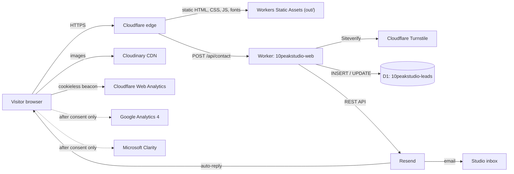
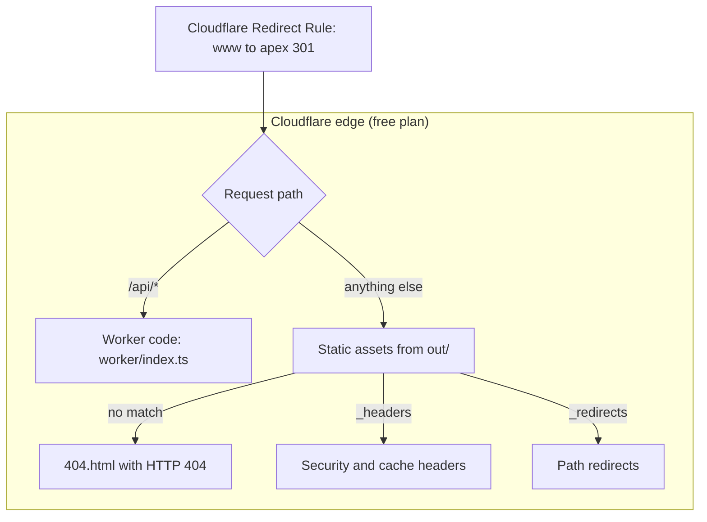
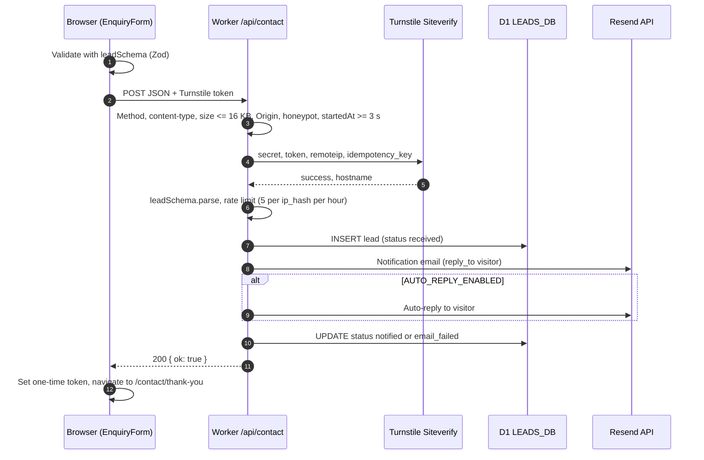
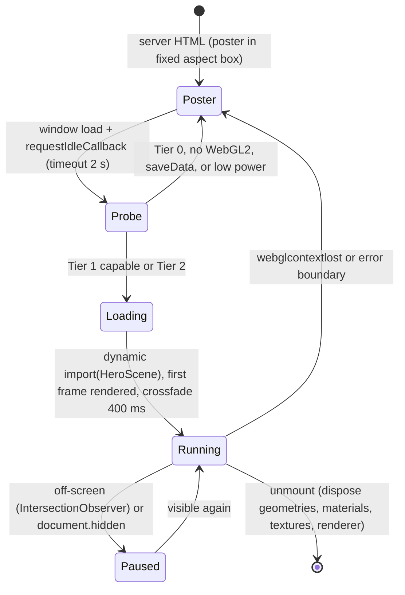
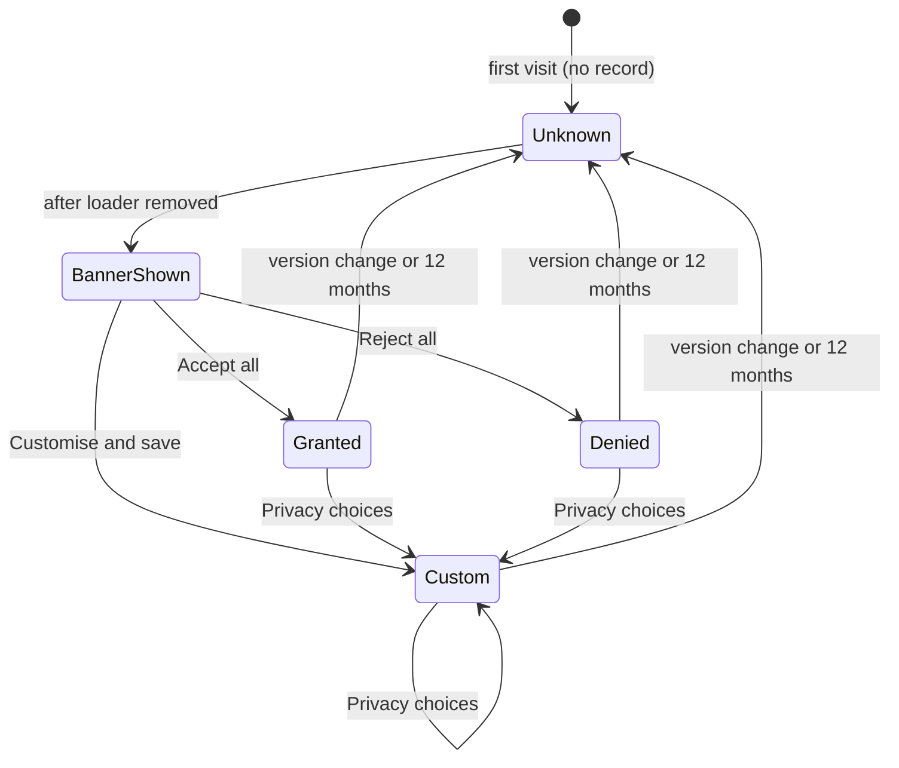
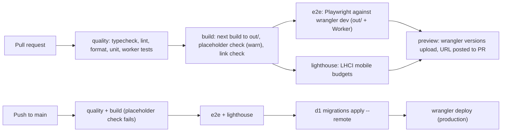

# 10PeakStudio Website - Architecture

## Table of contents

1. [Overview and principles](#1-overview-and-principles)
2. [Technology stack](#2-technology-stack)
3. [Repository and folder structure](#3-repository-and-folder-structure)
4. [Rendering strategy](#4-rendering-strategy)
5. [Cloudflare deployment design](#5-cloudflare-deployment-design)
6. [Form and lead data flow](#6-form-and-lead-data-flow)
7. [Image pipeline](#7-image-pipeline)
8. [Font pipeline](#8-font-pipeline)
9. [Animation architecture](#9-animation-architecture)
10. [SEO architecture](#10-seo-architecture)
11. [Analytics and consent architecture](#11-analytics-and-consent-architecture)
12. [Environment variables and secrets](#12-environment-variables-and-secrets)
13. [Security](#13-security)
14. [Performance budgets](#14-performance-budgets)
15. [Error handling and resilience](#15-error-handling-and-resilience)
16. [Testing strategy](#16-testing-strategy)
17. [CI/CD](#17-cicd)
18. [Verified facts register](#18-verified-facts-register)
19. [Architecture decision records](#19-architecture-decision-records)

---

## 1. Overview and principles

The site is a **Next.js static export** served by **Cloudflare Workers Static Assets** on the free plan, plus **one small Worker** that handles `/api/contact`. Everything else is pre-rendered HTML, CSS, JS and images. Requirements come from [PRD.md](PRD.md); binding rules from [Rules.md](Rules.md); visual tokens from [Design.md](Design.md).

| # | Principle |
|---|---|
| P1 | Free and Cloudflare-compatible only. No paid features, no hosted 3D runtimes, no paid assets. |
| P2 | Static first. Every page is HTML at build time; JavaScript enhances. |
| P3 | Mobile-first performance. Mid-range Android on 4G is the reference device. |
| P4 | Progressive motion. Motion tiers decide what runs; content never depends on animation. |
| P5 | Privacy by default. No non-essential tracking before consent; minimal data in forms. |
| P6 | Verify, do not assume. Volatile facts carry a source and date ([section 18](#18-verified-facts-register)). |

### 1.1 System context



---

## 2. Technology stack

Versions are the npm `latest` tags checked on 2026-11-05. Exact versions are pinned in `package.json` at scaffold time (M1) and re-checked then. "Locked" means user-decided in Company_info.md.

### 2.1 Runtime and framework

| Package | Version | Status | Reason | Free / Cloudflare check |
|---|---|---|---|---|
| next | 16.4.5 | Locked | App Router, metadata API, static export | MIT; `output: 'export'` produces plain files |
| react, react-dom | 19.3.1 | Locked | Required by Next 16 | MIT |
| typescript | 6.0.3 (pinned at M1: typescript-eslint supports < 6.1, so 7.x is not usable yet) | Locked | Strict typing | Apache-2.0 |
| tailwindcss, @tailwindcss/postcss | 4.3.4 | Locked | CSS-first `@theme` tokens | MIT |
| shadcn (CLI) | 4.23.0 | Locked | Accessible primitives copied into the repo | MIT; components live in source |
| radix-ui | 1.8.1 | Adopt (via shadcn) | Primitives for dialog, accordion, tabs, navigation menu | MIT |
| class-variance-authority, clsx, tailwind-merge, tw-animate-css | 0.7.1, 2.1.1, 3.7.0, 1.4.0 | Adopt (via shadcn) | Variants and class merging | MIT / Apache-2.0 |
| lucide-react | 1.68.0 | Locked | Line icons | ISC |

### 2.2 Motion and 3D

| Package | Version | Status | Reason | Free / Cloudflare check |
|---|---|---|---|---|
| gsap | 3.15.1 | Locked | Timelines, ScrollTrigger, SplitText, CustomEase | Standard "no charge" license, commercial use allowed; restriction applies only to competing visual animation builders |
| @gsap/react | n/a | Removed 2026-11-05 (unused) | Replaced by `useMotionEffect` (a `gsap.context` scoped to a ref) because GSAP is lazy-loaded after hydration | Same license |
| motion | 14.9.1 | Locked ("Framer Motion", now published as `motion`, imported from `motion/react`) | UI presence and layout transitions only | MIT |
| lenis | 1.3.27 | Locked | Smooth scroll synced to ScrollTrigger (Tier 2 only) | MIT |
| three | 0.187.0 | Adopt | Hero 3D | MIT; client-side chunk |
| @react-three/fiber | 9.8.2 | Adopt | React renderer for three (React 19 line) | MIT |
| @react-three/drei | 10.7.9 | Adopt (restricted) | Named helpers only; no CDN-loaded HDR presets | MIT |
| @types/three | 0.187.0 | Adopt (dev) | Types | MIT |

### 2.3 Forms, email, data

| Package / service | Version | Status | Reason | Free / Cloudflare check |
|---|---|---|---|---|
| react-hook-form | 7.91.0 | Locked | Form state | MIT |
| zod | 4.6.7 | Locked | Shared validation (client and Worker) | MIT |
| @hookform/resolvers | 7.0.2 | Adopt | Zod resolver | MIT |
| Cloudflare Turnstile | n/a | Locked | Spam protection | Free: 20 widgets, unlimited challenges |
| Resend (REST API via `fetch` in the Worker; `resend` SDK 6.37.0 optional) | API | Locked | Notification and auto-reply email | Free: 100 emails/day, 3,000/month, 1 domain |
| Cloudflare D1 | n/a | Adopt | Lead storage and rate limiting | Free: 5M row reads/day, 100k row writes/day, 500 MB per database |
| wrangler | 4.157.0 | Adopt (dev) | Build, dev and deploy for Workers (array `run_worker_first` needs >= 4.20.0) | MIT OR Apache-2.0 |
| @cloudflare/workers-types | 5.20261104.1 | Adopt (dev) | Worker types | MIT OR Apache-2.0 |

### 2.4 SEO, analytics, quality

| Package / service | Version | Status | Reason |
|---|---|---|---|
| schema-dts | 2.1.0 | Adopt (dev, types only) | Typed JSON-LD |
| Google Analytics 4, Microsoft Clarity | n/a | Locked | Consent-gated analytics |
| Cloudflare Web Analytics | n/a | Adopt | Cookieless baseline and RUM Core Web Vitals |
| Google Search Console, Bing Webmaster Tools | n/a | Locked | Indexing |
| eslint, prettier, husky, lint-staged | 10.14.0, 3.9.10, 9.1.7, 17.6.0 | Adopt | Quality gates (use the ESLint CLI; availability of `next lint` in 16.x is UNVERIFIED) |
| vitest, @cloudflare/vitest-pool-workers | 5.1.0, 0.23.0 | Adopt (Proposed) | Unit tests for schemas, consent logic and the Worker |
| @playwright/test, @axe-core/playwright | 1.64.1, 4.14.0 | Adopt | End-to-end, visual, accessibility and network tests |
| @lhci/cli | 0.16.0 | Adopt | Lighthouse CI budgets |
| @next/bundle-analyzer | 16.4.5 | Optional | Turbopack coverage UNVERIFIED |

### 2.5 Rejected or deferred

| Item | Verdict | Reason |
|---|---|---|
| @opennextjs/cloudflare 1.20.16 | Deferred fallback | Not needed for static export; Windows support not guaranteed (build via WSL or GitHub Actions if ever adopted) |
| vinext 1.4.3 | Rejected | Experimental |
| next-cloudinary 7.0.0 | Rejected | A small custom loader is simpler under static export |
| Spline, hosted 3D runtimes, paid asset libraries | Rejected | Constraint P1 |
| @react-three/postprocessing | Rejected by default | Mobile cost |
| Workers KV for leads | Rejected | 1,000 writes/day on free plan; not queryable |
| Next.js Cache Components (`cacheComponents`) | Disabled | Reported incompatible with static export (third-party sources, see [18](#18-verified-facts-register)); `create-next-app` 16.4 enables it by default, so M1 must disable it |
| Knowledge-base stack (Vercel, Supabase, Google Antigravity) | Overridden | Company_info.md locks Cloudflare hosting and Claude Code for this project |

---

## 3. Repository and folder structure

```
10PeakStudios/
├─ CLAUDE.md
├─ Project_spec/                     # PRD.md, Architecture.md, Rules.md, Design.md, Company_info.md
├─ design-system/10peakstudio/       # MASTER.md (+ pages/<page>.md overrides)
├─ src/
│  ├─ app/
│  │  ├─ layout.tsx                  # html lang="en-IN", fonts, global JSON-LD, loader, providers
│  │  ├─ page.tsx                    # Home
│  │  ├─ styleguide/page.tsx         # internal component review (noindex, not in sitemap; remove before launch)
│  │  ├─ not-found.tsx               # exported as 404.html
│  │  ├─ globals.css                 # Tailwind import, tokens, base styles
│  │  ├─ sitemap.ts
│  │  ├─ robots.ts
│  │  ├─ services/page.tsx
│  │  ├─ services/[slug]/page.tsx    # generateStaticParams, dynamicParams = false
│  │  ├─ about/page.tsx
│  │  ├─ about/process/page.tsx
│  │  ├─ security/page.tsx
│  │  ├─ contact/page.tsx
│  │  ├─ contact/thank-you/page.tsx
│  │  ├─ privacy/page.tsx
│  │  └─ terms/page.tsx
│  ├─ components/
│  │  ├─ ui/                         # shadcn primitives (customised to tokens)
│  │  ├─ layout/                     # Header, MegaMenu, MobileNav, Footer, SkipLink, StickyCtaBar, BackToTop
│  │  ├─ sections/                   # Hero, PillarGrid, Spotlight, ProcessSteps, AudienceGrid, FaqSection, CtaBand ...
│  │  ├─ brand/                      # Logo, LogoMark (inline SVG, namespaced gradient IDs), Loader
│  │  ├─ motion/                     # MotionProvider, SmoothScroll, Reveal, SplitHeading, PinnedSection
│  │  ├─ three/                      # HeroCanvas (lazy), scenes/, shaders/*.glsl, HeroPoster
│  │  ├─ forms/                      # EnquiryForm, steps/, TurnstileWidget, ErrorSummary
│  │  ├─ consent/                    # ConsentProvider, ConsentBanner, ConsentDialog, ScriptLoader
│  │  └─ seo/                        # JsonLd, Breadcrumbs
│  ├─ content/                       # site.ts, navigation.ts, services.ts, faqs.ts, process.ts (typed, single source)
│  ├─ lib/
│  │  ├─ schemas/lead.ts             # shared Zod schema (imported by the Worker)
│  │  ├─ analytics.ts                # typed event helpers
│  │  ├─ consent.ts                  # consent state, storage, versioning
│  │  ├─ motion-tier.ts              # tier detection
│  │  ├─ cloudinary-loader.ts        # next/image custom loader
│  │  ├─ seo.ts                      # metadata builders, JSON-LD builders (schema-dts)
│  │  └─ env.ts                      # Zod-validated public env
│  └─ styles/tokens.css              # brand tokens (see Design.md 7)
├─ worker/
│  ├─ index.ts                       # fetch handler: /api/contact, else ASSETS
│  ├─ contact.ts                     # request pipeline
│  ├─ turnstile.ts, resend.ts, ratelimit.ts, headers.ts, env.ts
├─ migrations/0001_leads.sql
├─ public/
│  ├─ brand/                         # original logo files (with C2PA metadata) for download
│  ├─ og/                            # 1200x630 static OG images
│  ├─ icons/                         # favicon.svg, apple-touch-icon.png (180), icon-192.png, icon-512.png
│  ├─ favicon.ico, site.webmanifest, llms.txt
│  ├─ _headers, _redirects
│  └─ hero-poster.avif               # 3D fallback poster
├─ tests/ (unit/, e2e/, visual/)
├─ scripts/                          # check-placeholders.mjs, check-links.mjs, extract-brand-assets.mjs, fix-segment-prefetch.mjs (postbuild),
│                                    # serve-out.mjs (local static server), capture-hero-poster.mjs, generate-og.mjs
├─ .github/workflows/ci.yml, deploy.yml
├─ next.config.ts, wrangler.jsonc, tsconfig.json, eslint.config.mjs, .prettierrc
├─ playwright.config.ts, vitest.config.ts, lighthouserc.json, components.json
├─ .dev.vars.example, .env.example, .gitignore, package.json
```

Brand assets: the 70 assets embedded in `10PeakStudio_Brand_Guidelines.html` are extracted at M1 into `public/brand/` (originals) and `src/components/brand/` (inline copies with `<metadata>` removed and gradient IDs namespaced). A matching set also exists in `C:\Users\Adarsh Korade\Downloads\files\`.

---

## 4. Rendering strategy

`next.config.ts` (target configuration):

```ts
const config: NextConfig = {
  output: 'export',
  trailingSlash: false,
  reactStrictMode: true,
  images: { loader: 'custom', loaderFile: './src/lib/cloudinary-loader.ts' },
  // cacheComponents must stay false/unset (incompatible with static export)
};
```

| Route | Rendering | Client islands |
|---|---|---|
| `/` | Static HTML at build | Header menus, Loader script, MotionProvider, HeroCanvas (lazy), FAQ accordion, Consent |
| `/services` | Static | Header, Reveal, FAQ, Consent |
| `/services/[slug]` | Static via `generateStaticParams()` over `content/services.ts`; `dynamicParams = false` | Same as above |
| `/about`, `/about/process`, `/security` | Static | Tabs (About), PinnedSection (Process, Tier 2) |
| `/contact` | Static | EnquiryForm, TurnstileWidget |
| `/contact/thank-you` | Static, `noindex` | One-time `generate_lead` emitter |
| `/privacy`, `/terms` | Static | ConsentDialog trigger |
| `404.html` | Static (`not-found.tsx`) | none |
| `/sitemap.xml`, `/robots.txt` | Generated at build from `sitemap.ts` and `robots.ts` (static metadata routes; confirm emission at M1) | n/a |
| `/api/contact` | Worker (dynamic) | n/a |

Static export limits accounted for: no API routes (use Worker), no `headers()`, `redirects()` or rewrites (use `_headers`, `_redirects`, Cloudflare Redirect Rules), no proxy/middleware, no ISR, no default image optimiser (custom loader), no reading request data at render.

Server/client boundary rule: components are Server Components by default; `'use client'` only on interactive leaves ([Rules.md 7](Rules.md#7-file-and-component-conventions)).

---

## 5. Cloudflare deployment design

### 5.1 Topology

One Worker named `10peakstudio-web` with static assets. Static asset requests are free and unlimited; only `/api/*` invokes Worker code and counts toward the free plan's 100,000 requests/day.



### 5.2 `wrangler.jsonc` (target)

Until M5 the committed config is assets-only (no `main`, no D1 binding, no `vars`); the Worker entry and D1 binding below are added with the enquiry form.

```jsonc
{
  "name": "10peakstudio-web",
  "main": "worker/index.ts",
  "compatibility_date": "<set to the current date at M1>",
  "assets": {
    "directory": "./out",
    "binding": "ASSETS",
    "not_found_handling": "404-page",
    "html_handling": "auto-trailing-slash",
    "run_worker_first": ["/api/*"]
  },
  "d1_databases": [
    { "binding": "LEADS_DB", "database_name": "10peakstudio-leads", "database_id": "<created at M5>" }
  ],
  "vars": {
    "LEAD_NOTIFY_TO": "connect@10peakstudios.com",
    "LEAD_FROM": "10PeakStudio <noreply@10peakstudios.com>",
    "ALLOWED_ORIGINS": "https://10peakstudios.com",
    "TURNSTILE_EXPECTED_HOSTNAME": "10peakstudios.com",
    "AUTO_REPLY_ENABLED": "true"
  },
  "observability": { "enabled": true }
}
```

`LEAD_NOTIFY_TO` and the sender address are pending [PRD OQ-2, OQ-4, OQ-16](PRD.md#17-open-questions).

### 5.3 Domains, HTTPS and environments

| Item | Design |
|---|---|
| Domain | `10peakstudios.com` on Cloudflare DNS; Worker attached as a Custom Domain on apex |
| `www` | Cloudflare Redirect Rule: `www.10peakstudios.com/*` to `https://10peakstudios.com/$1`, 301 |
| HTTPS | "Always Use HTTPS" on; HSTS via `_headers` (preload only after a stable month) |
| Environments | Production (`main` branch) and preview versions per pull request via `wrangler versions upload` |
| AI crawlers | AI Crawl Control configured per [PRD OQ-9](PRD.md#17-open-questions); verify Googlebot and Bingbot are allowed |
| Email DNS | Resend domain verification (SPF, DKIM) and a DMARC record for `10peakstudios.com` |

### 5.4 Free-plan capacity check

| Limit (free) | Value | Our usage |
|---|---|---|
| Worker requests/day | 100,000 | Form submissions only |
| CPU time per request | 10 ms | Validation and JSON handling; network waits are not CPU time |
| Worker size | 64 MiB uncompressed | Small handler |
| Static asset files per version | 20,000 | Under 500 expected |
| File size | 25 MiB | Largest asset is well under 1 MiB |
| Resend | 100 emails/day | 2 per lead (notification plus auto-reply), so about 50 leads/day; leads beyond that are still stored in D1 |
| D1 | 100k writes/day, 500 MB per database | About 2 writes per lead |

---

## 6. Form and lead data flow

### 6.1 Sequence



### 6.2 Responses

| Status | Body | When | Client behaviour |
|---|---|---|---|
| 200 | `{ ok: true }` | Lead stored (email may have failed) | Go to thank-you |
| 400 | `{ ok: false, error: "validation", fields: { name: "..." } }` | Zod failure | Show field errors and summary |
| 403 | `{ ok: false, error: "verification" }` | Turnstile failed, bad origin, honeypot or timing | Reset widget; ask to retry |
| 405 / 415 / 413 | `{ ok: false, error: "bad_request" }` | Wrong method, type or size | Generic error |
| 429 | `{ ok: false, error: "rate_limited" }` | Over limit | Ask to email or WhatsApp instead |
| 500 | `{ ok: false, error: "server" }` | D1 insert failed | Ask to email or WhatsApp; keep form data |

### 6.3 D1 schema (`migrations/0001_leads.sql`)

```sql
CREATE TABLE leads (
  id                TEXT PRIMARY KEY,               -- crypto.randomUUID()
  created_at        TEXT NOT NULL,                  -- ISO 8601 UTC
  name              TEXT NOT NULL,
  email             TEXT NOT NULL,
  company           TEXT,
  phone             TEXT,
  preferred_contact TEXT NOT NULL CHECK (preferred_contact IN ('email','whatsapp')),
  services          TEXT NOT NULL,                  -- JSON array of slugs
  budget_band       TEXT,
  timeline          TEXT,
  message           TEXT NOT NULL,
  utm               TEXT,                           -- JSON object
  landing_path      TEXT,
  referrer          TEXT,
  consent_version   TEXT NOT NULL,                  -- privacy notice version acknowledged
  ip_hash           TEXT NOT NULL,                  -- SHA-256(IP + IP_HASH_SALT); raw IP never stored
  status            TEXT NOT NULL DEFAULT 'received'
                    CHECK (status IN ('received','notified','email_failed'))
);
CREATE INDEX idx_leads_created ON leads (created_at);
CREATE INDEX idx_leads_ip_created ON leads (ip_hash, created_at);
```

Retention: rows older than the retention period ([PRD OQ-6](PRD.md#17-open-questions), default 12 months) are deleted by a scheduled Worker cron or a documented manual command (cron availability and limits on free plan: UNVERIFIED, check at M5).

### 6.4 Shared schema

`src/lib/schemas/lead.ts` exports `leadSchema` (Zod) and the inferred `Lead` type. The client uses it through `@hookform/resolvers/zod`; the Worker imports the same file. Field rules: [PRD.md 9.1](PRD.md#91-enquiry-form-project_enquiry).

---

## 7. Image pipeline

| Item | Design |
|---|---|
| Hosting | Cloudinary (free: 25 credits/month) for photographic and raster media; brand SVGs and icons are local |
| Loader | `src/lib/cloudinary-loader.ts`: returns `https://res.cloudinary.com/<cloud>/image/upload/f_auto,q_auto,c_limit,w_<width>/<publicId>` |
| Formats | `f_auto` (AVIF or WebP by browser support), `q_auto` |
| Sizes | Every `next/image` has explicit `sizes`; widths from Next defaults |
| LCP | Hero LCP is text. Any above-the-fold image uses `priority` and a fixed aspect ratio |
| Hero poster | `public/hero-poster.avif`, <= 60 KB, same aspect ratio as the canvas, local (no Cloudinary dependency for the first paint) |
| Below the fold | `loading="lazy"` (Next default) |
| Alt text | Required prop in a wrapper component; empty string only for decorative images |
| Credits guard | If Cloudinary credits run out, images fall back to local copies in `public/media/` (documented switch in `env.ts`) |

---

## 8. Font pipeline

| Family | Loader | Weights | Subsets | Use |
|---|---|---|---|---|
| Sora | `next/font/google` (self-hosted at build) | Variable; used 300, 600, 700 | `latin` | Headings, display numerals |
| Inter | `next/font/google` | Variable; used 400, 500, 600 | `latin`, `latin-ext` (required: ₹ U+20B9 is in `latin-ext`, verified) | Body, UI, prices |
| JetBrains Mono | `next/font/google`, loaded only where code appears | 400 | `latin` | Code |

Rules: `display: 'swap'`; preload Sora and Inter `latin` only; CSS variables `--font-sora`, `--font-inter`, `--font-jetbrains-mono` mapped in [Design.md 7](Design.md#7-token-implementation). Total woff2 budget in [section 14](#14-performance-budgets). No request to Google Fonts at runtime.

---

## 9. Animation architecture

### 9.1 Responsibilities

| Library | Owns | Never used for |
|---|---|---|
| GSAP + ScrollTrigger | Scroll reveals, pinned sections, scrubbed timelines, hero intro, SplitText headings | Menu or dialog presence |
| Lenis | Smooth scrolling (Tier 2 only) | Touch devices, reduced motion |
| Motion (`motion/react`) | Presence and layout of UI: mega-menu, mobile drawer, accordion height, toasts, consent banner | Scroll-driven effects |
| React Three Fiber | Hero 3D scene | Anything outside the hero |
| CSS | Loader, hover and focus transitions | Scroll logic |

### 9.2 Motion tiers

Tier detection (`src/lib/motion-tier.ts`), evaluated once on the client and on media-query change:

| Tier | Condition | Behaviour |
|---|---|---|
| 0 | `prefers-reduced-motion: reduce` | No loader, no Lenis, no ScrollTrigger animation, no SplitText, hero shows poster, content in final state |
| 1 | `(hover: none) and (pointer: coarse)`, or viewport < 1024 px, or `navigator.connection.saveData`, or `effectiveType` in `slow-2g`, `2g`, `3g`, or `hardwareConcurrency <= 4`, or `deviceMemory <= 4` | Reveals only (short, small offsets), no pinning, no Lenis, no SplitText; lite 3D scene only if the `TIER1_LITE_SCENE` switch is on (default off, ADR-011) and WebGL2 and `hardwareConcurrency >= 6` and not `saveData`, else poster |
| 2 | Everything else | Lenis, ScrollTrigger reveals and up to 2 pinned sections per page, SplitText on short H2 headlines, full 3D scene |

An inline head script sets `data-motion-tier` on `<html>` before first paint so CSS can avoid flashes; `MotionProvider` refines it after hydration.

### 9.3 Single animation loop

```ts
// Tier 2 only
const lenis = new Lenis({ autoRaf: false });
lenis.on('scroll', ScrollTrigger.update);
gsap.ticker.add((time) => lenis.raf(time * 1000));
gsap.ticker.lagSmoothing(0);
// R3F canvas uses frameloop="never"; HeroCanvas calls advance(performance.now() / 1000) from gsap.ticker while visible.
// The value must be in seconds: in "never" mode R3F stores it as clock.elapsedTime and derives delta from it.
```

All effects are created inside `useMotionEffect(scope, effect)` (a `gsap.context` scoped to a ref; the lazy-load equivalent of `useGSAP`) and `gsap.matchMedia()` so they revert automatically on unmount, breakpoint change or reduced-motion change. `ScrollTrigger.refresh()` runs after `document.fonts.ready`, then `html[data-motion-ready]` is set. The hero visual sits in a fixed aspect box, so the poster-to-scene swap needs no refresh. Pinned sections do not use `anticipatePin` (with Lenis it pinned 37 px early).

### 9.4 Hero 3D lifecycle



| Setting | Desktop (Tier 2) | Mobile lite (Tier 1) |
|---|---|---|
| Device pixel ratio cap | 1.75 | 1.25 |
| Particle count (concept B) | <= 12,000 | <= 3,000 |
| Antialias | On | Off (rely on DPR) |
| Pointer reaction | Yes | No (gyroscope not used) |
| Scroll reaction | Scrubbed with ScrollTrigger | Static pose |

Assets: procedural geometry and custom GLSL only; any GLB must be self-hosted, Draco or Meshopt compressed, with KTX2 textures and a CC0 or equivalent license recorded in the spec.

### 9.5 Loader lifecycle

| Step | Behaviour |
|---|---|
| 1 Head script (inline, before paint) | If `sessionStorage['tps.loader.seen']` exists or reduced motion is on, set `html[data-loader="off"]`; CSS hides the loader immediately |
| 2 First paint | Loader markup (inline SVG of the 3D Light logomark with 6 named paths, plus end-frame lockup) is server-rendered at the top of `<body>` with inline critical CSS; real page content renders underneath |
| 3 Animation | Pure CSS keyframes (no JavaScript needed); timings in [Design.md 11.6](Design.md#116-logo-loader-specification); total <= 1.9 s |
| 4 Skip | "Skip intro" button, any key press or a click ends the animation immediately |
| 5 End | Overlay fades out (CSS), then a small script removes the node and sets `tps.loader.seen`; a CSS fail-safe makes the overlay invisible and non-interactive at 2.2 s even if JavaScript never runs |
| 6 Accessibility | Overlay is `aria-hidden="true"` except the skip button; focus is never moved into it; screen readers read the page content directly |
| 7 Measurement | Lighthouse LCP with loader must be within 100 ms of LCP without loader (M3 exit criterion); LCP behaviour under an overlay is UNVERIFIED until measured |

---

## 10. SEO architecture

| Concern | Implementation |
|---|---|
| Metadata | `export const metadata` per page, built by `lib/seo.ts` from `content/*`; `metadataBase = new URL('https://10peakstudios.com')`; title template `%s \| 10PeakStudio` (Home sets its full title) |
| Canonical | `alternates.canonical` on every indexed page |
| Open Graph / Twitter | Static PNGs in `public/og/` (1200 x 630): one per service plus defaults; generated at design time, not with `next/og` at build (behaviour under static export UNVERIFIED) |
| JSON-LD | `components/seo/JsonLd.tsx` renders `<script type="application/ld+json">` from typed builders (`schema-dts`); content is static and escaped (`<` replaced with `\u003c`) |
| Sitemap | `app/sitemap.ts` builds from the route table in `content/navigation.ts`; excludes `noindex` pages |
| Robots | `app/robots.ts`: allow `/`, disallow `/api/`, sitemap URL |
| llms.txt | Static file `public/llms.txt` generated from `content/*` by a build script |
| Indexing | Search Console (DNS verification), Bing Webmaster Tools (import from Search Console); IndexNow via Cloudflare Crawler Hints (Optional, free) |
| Link integrity | `scripts/check-links.mjs` crawls `out/` in CI; any broken internal link fails the build |

---

## 11. Analytics and consent architecture

### 11.1 Consent state

```ts
type ConsentState = {
  version: 1;                // bump when categories or processors change
  timestamp: string;         // ISO 8601
  analytics: boolean;        // GA4
  sessionInsights: boolean;  // Microsoft Clarity
};
// localStorage key: "tps.consent.v1"; re-prompt after 12 months or version change
```



### 11.2 Script loading

| Script | Loaded by | Condition | Configuration |
|---|---|---|---|
| Cloudflare Web Analytics beacon | `layout.tsx` (`defer`) | Always (config flag `CF_WA_REQUIRES_CONSENT=false`; switchable after legal review) | Token from `NEXT_PUBLIC_CF_WA_TOKEN` |
| GA4 `gtag.js` | `ScriptLoader` (client) | `analytics === true` | `gtag('consent','default',{ ad_storage:'denied', ad_user_data:'denied', ad_personalization:'denied', analytics_storage:'granted' })` before `config`; Google signals and ad personalisation disabled in GA4 admin |
| Clarity tag | `ScriptLoader` | `sessionInsights === true` | Immediately after load: `clarity('consentv2', { ad_Storage: 'denied', analytics_Storage: 'granted' })`; masking mode Strict in the Clarity dashboard plus `data-clarity-mask="true"` on the form |
| Turnstile `api.js` | `TurnstileWidget` | When step 3 of the form mounts | Necessary (security) |

On withdrawal: stop sending events, call `clarity('consentv2', { ad_Storage: 'denied', analytics_Storage: 'denied' })` if loaded, delete `_ga*` and `_clck`/`_clsk` cookies on the current domain, and reload the page to unload scripts.

### 11.3 Event layer

`lib/analytics.ts` exposes `track(event, params)` typed against the event dictionary in [PRD.md 10.2](PRD.md#102-event-dictionary-ga4). It is a no-op until GA4 is loaded; it strips any key outside the allow-list so personal data cannot be sent.

---

## 12. Environment variables and secrets

| Name | Scope | Where set | Secret | Example / note |
|---|---|---|---|---|
| `NEXT_PUBLIC_SITE_URL` | Build (client) | `.env.local`, CI | No | `https://10peakstudios.com` |
| `NEXT_PUBLIC_TURNSTILE_SITE_KEY` | Build | CI | No | Test key in development |
| `NEXT_PUBLIC_GA4_ID` | Build | CI | No | `G-XXXXXXX` |
| `NEXT_PUBLIC_CLARITY_ID` | Build | CI | No | Project ID |
| `NEXT_PUBLIC_CF_WA_TOKEN` | Build | CI | No | Web Analytics token |
| `NEXT_PUBLIC_CLOUDINARY_CLOUD_NAME` | Build | CI | No | Cloud name |
| `NEXT_PUBLIC_CONTACT_EMAIL` | Build | CI | No | Pending PRD OQ-2 |
| `NEXT_PUBLIC_WHATSAPP_NUMBER` | Build | CI | No | Digits only, country code first; empty hides WhatsApp CTAs |
| `TURNSTILE_SECRET_KEY` | Worker | `wrangler secret put` / `.dev.vars` | **Yes** | |
| `RESEND_API_KEY` | Worker | `wrangler secret put` / `.dev.vars` | **Yes** | Sending-only scope |
| `IP_HASH_SALT` | Worker | `wrangler secret put` / `.dev.vars` | **Yes** | 32+ random bytes |
| `LEAD_NOTIFY_TO`, `LEAD_FROM`, `ALLOWED_ORIGINS`, `TURNSTILE_EXPECTED_HOSTNAME`, `AUTO_REPLY_ENABLED` | Worker | `wrangler.jsonc` `vars` | No | See [5.2](#52-wranglerjsonc-target) |
| `CLOUDFLARE_API_TOKEN`, `CLOUDFLARE_ACCOUNT_ID` | CI deploy | GitHub Actions secrets | **Yes** | Token scoped to Workers and D1 for this account |

Validation: `src/lib/env.ts` (public build variables) and `worker/env.ts` (Worker bindings) parse with Zod at startup; the build fails on a missing required public variable. `.env*.local` and `.dev.vars` are git-ignored; `.env.example` and `.dev.vars.example` list names only.

---

## 13. Security

### 13.1 Static response headers (`public/_headers`)

```
/*
  Strict-Transport-Security: max-age=31536000; includeSubDomains
  X-Content-Type-Options: nosniff
  Referrer-Policy: strict-origin-when-cross-origin
  Permissions-Policy: camera=(), microphone=(), geolocation=(), payment=(), usb=(), browsing-topics=()
  X-Frame-Options: DENY
  Cross-Origin-Opener-Policy: same-origin
  Content-Security-Policy: default-src 'self'; script-src 'self' 'unsafe-inline' https://challenges.cloudflare.com https://www.googletagmanager.com https://www.clarity.ms https://*.clarity.ms https://static.cloudflareinsights.com; style-src 'self' 'unsafe-inline'; img-src 'self' data: blob: https://res.cloudinary.com https://*.google-analytics.com https://*.googletagmanager.com https://*.clarity.ms https://c.bing.com; font-src 'self'; connect-src 'self' https://*.google-analytics.com https://*.analytics.google.com https://www.googletagmanager.com https://*.clarity.ms https://cloudflareinsights.com; frame-src https://challenges.cloudflare.com; worker-src 'self' blob:; object-src 'none'; base-uri 'self'; form-action 'self'; frame-ancestors 'none'; upgrade-insecure-requests

/_next/static/*
  Cache-Control: public, max-age=31536000, immutable

/fonts/*
  Cache-Control: public, max-age=31536000, immutable
```

HTML keeps Cloudflare's default revalidation behaviour. Header rules are limited to 100 and do not apply to Worker-generated responses.

**CSP trade-off (ADR-008):** `script-src` includes `'unsafe-inline'` in R1 because a static export inlines per-page scripts (React Server Component payload, loader and tier bootstrap) and nonces need a server. This is expected to still hold for Next 16.4 (confirm at M1). Mitigations: no user-generated HTML, no `dangerouslySetInnerHTML` except escaped static JSON-LD, strict host allow-list, `object-src 'none'`, `base-uri 'self'`. R2 hardening: a post-build script computes SHA-256 hashes of inline scripts per page and writes per-route CSP rules.

### 13.2 Worker hardening (`/api/contact`)

| Control | Implementation |
|---|---|
| Method and type | `POST` with `application/json` only |
| Size | Reject bodies > 16 KB (check `Content-Length`, then the read length) |
| Origin | `Origin` must be in `ALLOWED_ORIGINS` |
| Bot defence | Honeypot empty; `startedAt` >= 3 s old; Turnstile Siteverify with `remoteip` and `idempotency_key`; hostname check |
| Validation | `leadSchema.parse`; strings trimmed; control characters stripped |
| Rate limit | 5 per `ip_hash` per hour (D1 count); Cloudflare WAF rate limiting rule added if the free plan allows (UNVERIFIED) |
| Data minimisation | Raw IP never stored; only hashed with a secret salt |
| Email safety | Resend JSON API (no header injection); user content HTML-escaped in templates; `reply_to` only after email validation |
| Response headers | Set in code: `Content-Type`, `Cache-Control: no-store`, `X-Content-Type-Options`, CORS limited to own origin |
| Logging | Error type and lead ID only; never names, emails, phone numbers or messages |
| Secrets | Wrangler secrets; never in the repository or client bundle |

### 13.3 Supply chain

Dependencies pinned with a lockfile; `npm audit --omit=dev` in CI (high severity fails); Dependabot or Renovate weekly; new dependencies follow [Rules.md 14](Rules.md#14-dependency-rules).

---

## 14. Performance budgets

These numbers are canonical; [PRD.md](PRD.md) and [Rules.md](Rules.md) reference them.

| Metric | Budget | Measured by |
|---|---|---|
| LCP (mobile, p75 field; Lighthouse lab) | <= 2.5 s (aim <= 2.0 s) | Cloudflare Web Analytics RUM, Lighthouse CI |
| INP (p75 field) | <= 200 ms | Cloudflare Web Analytics RUM |
| TBT (lab proxy for INP) | <= 200 ms | Lighthouse CI |
| CLS | <= 0.1 (aim <= 0.05) | RUM, Lighthouse CI |
| Lighthouse mobile | Performance >= 90; Accessibility, Best Practices, SEO >= 95 | Lighthouse CI (3 runs, median) |
| Initial JS per route (gzip) | <= 150 KB; Home <= 180 KB excluding the deferred 3D chunk | Lighthouse `resource-summary`, build output |
| Hero 3D chunk (gzip) | <= 250 KB, loaded after idle and only on capable devices | Build output |
| Fonts (woff2 total) | <= 120 KB | Network panel / Lighthouse |
| Inline loader (SVG + CSS + JS, gzip) | <= 4 KB | Build script |
| Hero poster | <= 60 KB AVIF | File size check |
| Any content image | <= 200 KB delivered | Cloudinary `q_auto`, Lighthouse |
| Third-party JS before consent | Cloudflare beacon only | Playwright network assertions |

---

## 15. Error handling and resilience

| Scenario | Behaviour |
|---|---|
| Unknown URL | `404.html` with HTTP 404 |
| JavaScript disabled or failed | All content readable; loader disappears via CSS fail-safe; navigation works through links; the form shows email and WhatsApp alternatives inside `<noscript>` |
| WebGL unavailable, context lost or scene error | Error boundary shows the poster; no console error is surfaced to users |
| Font load slow | `font-display: swap` with metric-adjusted fallbacks from `next/font` |
| Turnstile fails to load | Form shows "Verification could not load" plus email and WhatsApp alternatives |
| Worker 5xx or network failure | Form keeps data, shows retry, offers email and WhatsApp |
| Resend failure | Lead kept in D1 with `email_failed`; studio reviews D1 daily until a retry job exists |
| Cloudinary unavailable or out of credits | Local fallback images (see [7](#7-image-pipeline)) |
| Consent storage blocked | Treated as no consent; banner shown each visit; nothing non-essential loads |

---

## 16. Testing strategy

| Layer | Tool | Scope | Gate |
|---|---|---|---|
| Static | `tsc --noEmit`, ESLint, Prettier | All code | CI fails on error |
| Unit | Vitest | `leadSchema`, consent state machine, motion-tier detection, Cloudinary loader, SEO builders | CI fails on error |
| Worker | Vitest + `@cloudflare/vitest-pool-workers` | `/api/contact` pipeline: each status code path, rate limit, email failure | CI fails on error |
| End-to-end | Playwright (Chromium, WebKit, Firefox; Pixel 7 and iPhone 14 profiles) | Navigation, mega-menu and drawer keyboard flow, form happy path with Turnstile test keys, form error paths, thank-you single event | CI fails on error |
| Consent | Playwright network assertions | No request to googletagmanager.com, google-analytics.com or clarity.ms before consent; requests after Accept; none after Reject | CI fails on error |
| Accessibility | `@axe-core/playwright` on every route | Zero serious or critical violations | CI fails on error |
| Motion | Playwright `reducedMotion: 'reduce'` | Loader absent, content visible, no ScrollTrigger pins | CI fails on error |
| No-JS | Playwright `javaScriptEnabled: false` | Content and links present, loader not blocking | CI fails on error |
| Visual | Playwright screenshots at 360, 768, 1024, 1280, 1440 widths | Key pages and components | Reviewed on change |
| Performance | Lighthouse CI (mobile preset) | Every route | Budgets in [14](#14-performance-budgets) |
| Content | `scripts/check-placeholders.mjs` | No `[PLACEHOLDER` in `out/` | Fails production build only |
| Links | `scripts/check-links.mjs` | No broken internal links | CI fails on error |

Turnstile test keys (always pass, always fail) are used in CI; production keys only in production builds.

---

## 17. CI/CD



| Item | Design |
|---|---|
| Runner | GitHub Actions `ubuntu-latest`, Node 24 LTS (local machine has v24.11.1); Linux avoids Windows tooling issues |
| Package manager | npm with `package-lock.json`; `npm ci` in CI |
| Secrets | `CLOUDFLARE_API_TOKEN`, `CLOUDFLARE_ACCOUNT_ID`, production public keys |
| Branch protection | `main` requires all checks green and one review |
| Rollback | `wrangler rollback` to the previous version |
| Free-tier note | GitHub Actions minutes for private repositories: UNVERIFIED; Workers Builds (3,000 build minutes/month free) is the fallback deploy path |

---

## 18. Verified facts register

All checked on 2026-11-05 unless noted. Re-verify before relying on a value that has changed category (for example, a plan rename).

| Fact | Source |
|---|---|
| Workers Free: 100,000 requests/day, 10 ms CPU per request, 64 MiB uncompressed Worker size, 20,000 static files per version, 25 MiB per file | https://developers.cloudflare.com/workers/platform/limits/ |
| Static asset requests are free and unlimited; Workers Static Assets recommended over Pages for new projects | https://developers.cloudflare.com/workers/static-assets/ ; https://developers.cloudflare.com/pages/platform/limits/ |
| Pages Free 500 builds/month; Workers Builds 3,000 build minutes/month | https://developers.cloudflare.com/pages/platform/limits/ ; https://developers.cloudflare.com/workers/ci-cd/builds/limits-and-pricing/ |
| `not_found_handling: "404-page"` serves nearest 404.html with 404 status; `run_worker_first` accepts an array (max 100, Wrangler >= 4.20.0) | https://developers.cloudflare.com/workers/static-assets/routing/static-site-generation/ ; https://developers.cloudflare.com/workers/static-assets/binding/ |
| `_headers` and `_redirects` supported; not applied to Worker-generated responses; 100 header rules; 2,000 static + 100 dynamic redirects | https://developers.cloudflare.com/workers/static-assets/headers/ ; https://developers.cloudflare.com/workers/static-assets/redirects/ |
| OpenNext Cloudflare: Windows full support not guaranteed; WSL or Linux CI recommended | https://opennext.js.org/cloudflare |
| Cloudflare now points Next.js on Workers to vinext (experimental) | https://developers.cloudflare.com/workers/framework-guides/web-apps/nextjs/ ; https://github.com/cloudflare/vinext |
| GSAP including SplitText free for commercial use under the standard no-charge license (from 2025-04-30) | https://gsap.com/community/standard-license/ ; https://webflow.com/blog/gsap-becomes-free |
| Framer Motion succeeded by `motion`; React import `motion/react` | https://motion.dev/react |
| Resend Free: 100 emails/day; 3,000/month; 1 domain | https://resend.com/pricing ; https://resend.com/blog/new-free-tier |
| Turnstile Free: up to 20 widgets, 10 hostnames per widget, unlimited challenges | https://developers.cloudflare.com/turnstile/plans/ |
| Cloudinary Free: 25 credits/month shared across storage, bandwidth, transformations | https://cloudinary.com/documentation/billing_and_plans |
| D1 Free: 5M row reads/day, 100k row writes/day, 500 MB per database, 5 GB per account; queries fail over limit from 2026-09-01 | https://developers.cloudflare.com/d1/platform/limits/ ; https://developers.cloudflare.com/changelog/post/2026-09-01-d1-free-tier-limit-enforcement/ |
| KV Free: 100k reads/day, 1k writes/day, 1 GB | https://developers.cloudflare.com/kv/platform/limits/ |
| Cloudflare Web Analytics is free and uses no cookies or localStorage | https://developers.cloudflare.com/web-analytics/about/ |
| Next.js 16.4 latest feature release (2026-10-06); 16.4.5 patched in the November 2026 security release | https://nextjs.org/blog/next-16-4 ; https://nextjs.org/blog/november-2026-security-release |
| Static export does not support API routes, rewrites, redirects, headers, proxy, ISR, default image loader, draft mode | https://nextjs.org/docs/pages/guides/static-exports |
| Cache Components reported incompatible with static export (third-party; re-check official docs at M1) | https://playbooks.com/skills/vercel-labs/next-skills/next-cache-components |
| Inter ₹ (U+20B9) is in the `latin-ext` subset (range U+20AD-20C4), not `latin` | https://fonts.googleapis.com/css2?family=Inter (response inspected) |
| Clarity `consentv2` with `ad_Storage` and `analytics_Storage` is the recommended consent API; enforcement for EEA, UK and Switzerland from 2025-10-31 | https://learn.microsoft.com/en-us/clarity/setup-and-installation/clarity-consent-api-v2 ; https://learn.microsoft.com/en-us/clarity/setup-and-installation/cookie-gcm |
| Cloudflare AI crawler defaults for new domains changed from 2026-09-15; blocking "Training" can also block multi-purpose crawlers such as Googlebot and Bingbot | https://developers.cloudflare.com/changelog/post/2026-07-01-ai-traffic-options/ ; https://developers.cloudflare.com/ai-crawl-control/features/manage-ai-crawlers/ |
| India DPDP Rules notified November 2025; consent managers from 13 Nov 2026; core obligations about 18 months after notification (May 2027) | https://www.azbpartners.com/bank/indias-digital-personal-data-protection-act-phased-rollout-and-key-compliance-milestones/ (secondary legal source) |
| Package versions in [section 2](#2-technology-stack) | npm registry (`npm view <pkg> version`) |
| Resolved at M1 to M3 (measured locally 2026-11-05): TypeScript pinned to 6.0.3 (typescript-eslint peer range < 6.1); `sitemap.xml` and `robots.txt` are emitted by metadata routes under static export; static export inlines per-page scripts (RSC payload), confirming ADR-008; LCP with the loader 3356 ms vs without 3369 ms (Lighthouse mobile median, within 100 ms); `experimental.inlineCss` embeds the CSS twice (Home HTML 39.7 KB to 92.9 KB gzip), so it is not used; R3F 9.8.2 `advance(timestamp)` in `frameloop="never"` sets `clock.elapsedTime = timestamp` | Build output, Lighthouse CI, `node_modules/@react-three/fiber` source |
| Lighthouse mobile on `/` (2026-11-05, 3 runs): Performance 0.86 to 0.88 (below the 0.90 gate), Accessibility 1.00, Best Practices 0.96, SEO 1.00; LCP 3.3 s, TBT 181 to 237 ms, CLS 0. The simulated LCP counts about 353 KB requested before first paint (framework JS 132 KB, app JS 41 KB, fonts 81 KB, poster, HTML, CSS) | `npm run lhci` |

**UNVERIFIED (check at the milestone shown):** `.assetsignore` need for `_headers` and `_redirects` (M1); `next lint` availability (M1); free-plan WAF rate limiting rules and Worker cron limits (M5); Turnstile Siteverify rate limits (M5); Cloudinary credit window (M5); `next/og` under static export (M6); Google FAQ rich result eligibility (M6); GitHub Actions free minutes (M1).

---

## 19. Architecture decision records

| ADR | Decision | Status | Rationale | Alternatives rejected |
|---|---|---|---|---|
| ADR-001 | Next.js static export | Accepted | Free, fastest, no server runtime, every page pre-rendered | OpenNext (complexity, Windows), vinext (experimental) |
| ADR-002 | Workers Static Assets with one Worker | Accepted | Cloudflare's recommended path; free unlimited static requests; same deployment hosts `/api/contact` | Pages plus Pages Functions |
| ADR-003 | Cloudinary custom loader | Accepted | Works with static export; `f_auto,q_auto` | next-cloudinary, unoptimised images |
| ADR-004 | D1 stores every lead | Accepted | Leads survive email limits or failures; enables rate limiting | Email-only, KV |
| ADR-005 | GSAP owns scroll; Motion limited to UI presence; single ticker | Accepted | Both are locked; scoping avoids duplicate loops and bundle waste | Motion for scroll effects |
| ADR-006 | Consent-gated GA4 and Clarity; Cloudflare Web Analytics baseline | Accepted | Legal safety plus continuous cookieless measurement | Load-then-ask, region-only banner (needs a server) |
| ADR-007 | Self-hosted fonts via `next/font` | Accepted | Performance, privacy, simpler CSP | Google Fonts CDN link (as used in the brand guide page) |
| ADR-008 | CSP with `'unsafe-inline'` scripts in R1; hash-based CSP in R2 | Accepted | Static export cannot use nonces | Strict nonce CSP (needs server rendering) |
| ADR-009 | Cache Components disabled | Accepted | Incompatible with static export | n/a |
| ADR-010 | Brand-first `MASTER.md` reconciled by hand | Accepted | Skill regeneration returned off-brand palettes and fonts twice | Regenerate with `--force` |
| ADR-011 | Tier 1 shows the hero poster only (`TIER1_LITE_SCENE = false`) | Proposed | Most mid-range Android phones report 8 cores, so the lite scene would load three.js on the reference device and add main-thread time; Design.md 11.3 allows "lite scene or poster" | Lite scene on capable Tier 1 devices |
| ADR-012 | Logos render as `` from `public/logos/` (metadata-stripped copies of the supplied files); only the loader inlines SVG | Proposed | Keeps large SVG path data out of the HTML and RSC payload (less hydration work); one art-directed `<picture>` in the header loads a single file | Inline SVG components everywhere |
| ADR-013 | Postbuild `fix-segment-prefetch.mjs` writes dot-joined copies of segment prefetch files | Proposed | Next 16.4 static export nests segment files in folders while the client requests dot-joined names (404s on Workers Static Assets) | Disabling prefetch |
